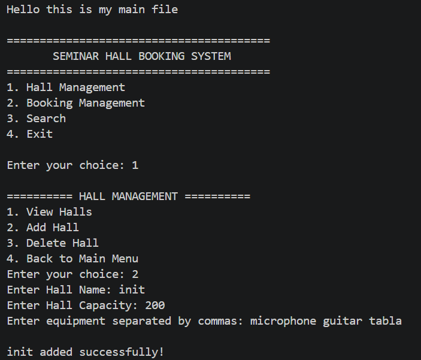
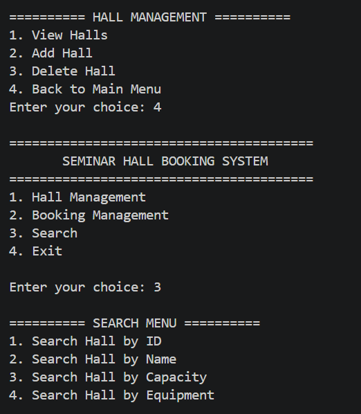
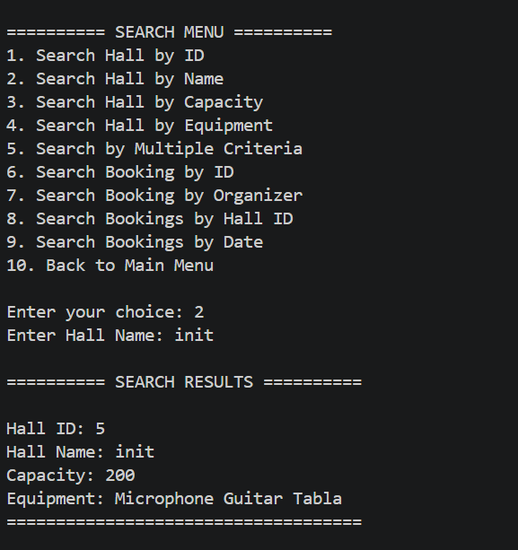

# Seminar Hall Booking System

A Python-based, menu-driven Seminar Hall Booking System that allows users to manage seminar halls, create and manage bookings, check hall availability, and search for halls and bookings.

## 1. Project Overview

The Seminar Hall Booking System is developed using Python. It provides a simple, interactive, console-based interface through which users can manage halls and bookings efficiently.

The system is divided into independent modules to make the code organised, reusable, and easier to maintain.

## 2. Features

### Hall Management
- View all available seminar halls.
- Add new seminar halls.
- Delete existing halls.
- Assign hall IDs automatically.
- Validate hall names to prevent duplicate hall entries.
- Store hall capacity and available equipment.

### Booking Management
- Book a seminar hall for an event.
- View all existing bookings.
- Cancel an existing booking.
- Validate organizer and event details.
- Validate attendee count against hall capacity.
- Validate booking date and time.
- Prevent bookings for past dates and invalid time slots.
- Generate unique booking IDs.

### Hall Availability and Duplicate Booking Prevention
- Check whether a hall is available for a selected date and time.
- Prevent two bookings from overlapping in the same hall.
- Allow bookings in different halls at the same time.
- Allow adjacent bookings when one booking ends exactly when another begins.

### Search Module
Users can search using the following criteria:

**Hall Search**
- Search hall by ID.
- Search hall by name.
- Search halls by minimum capacity.
- Search halls by equipment.
- Search using multiple criteria (capacity and equipment).

**Booking Search**
- Search booking by ID.
- Search bookings by organizer.
- Search bookings by hall ID.
- Search bookings by date.

## 3. Technologies Used

- **Programming Language:** Python
- **Date and Time Handling:** Python `datetime` module
- **Testing:** Python test scripts
- **Version Control:** Git and GitHub
- **Development Environment:** Visual Studio Code

## 4. Project Structure

```text
Seminar-Hall-Booking-System/
│
├── main.py
├── hallManagement.py
├── booking_management.py
├── search.py
├── Test.py
└── README.md
```

### Module Description

| File | Description |
|---|---|
| `main.py` | Main menu and navigation between modules |
| `hallManagement.py` | Hall creation, viewing, deletion and management |
| `booking_management.py` | Booking, cancellation, viewing and availability checking |
| `search.py` | Search functionality for halls and bookings |
| `Test.py` | Test cases for checking booking functionality |
| `README.md` | Project documentation |

## 5. Main Menu-Driven Program

The application starts through `main.py`, which provides the main menu.

The main menu connects the different modules:

1. Hall Management
2. Booking Management
3. Search
4. Exit

Each module has its own submenu, allowing users to perform the required operations and return to the main menu.

## Main Menu and Hall Management



## Navigation to Search



## Search Results



## 6. Hall Management

The Hall Management module provides functionality to add, view and delete seminar halls.

Each hall contains:
- Hall ID
- Hall Name
- Capacity
- Available Equipment


## 7. Booking Management

The Booking Management module handles the complete booking process.

Each booking stores:
- Booking ID
- Organizer Name
- Event Name
- Number of Attendees
- Hall ID
- Hall Name
- Equipment
- Booking Date
- Start Time
- End Time

### Booking Validation

The system performs the following validations:
- Attendee count must be positive.
- Attendee count cannot exceed hall capacity.
- Hall ID must be valid.
- Booking date must be valid and cannot be in the past.
- Start time must be earlier than end time.
- A hall cannot have overlapping bookings on the same date.


## 8. Search Functionality

The Search module provides separate search options for halls and bookings.

It supports searching through individual fields as well as multiple criteria.


## 9. Test Cases

The booking availability function was tested using different scenarios to verify that the system correctly handles overlapping and non-overlapping bookings.

| Test Case | Scenario | Expected Result |
|---|---|---|
| TC01 | Same hall, same date, overlapping time | Booking rejected |
| TC02 | Same hall, same date, adjacent time slots | Booking allowed |
| TC03 | Different halls, same date and time | Booking allowed |
| TC04 | Same hall, different dates | Booking allowed |
| TC05 | Exact duplicate booking | Booking rejected |

### Test Results

The availability tests were executed using temporary booking records.

| Test Case | Result |
|---|---|
| TC01 – Overlapping booking | PASS |
| TC02 – Adjacent booking | PASS |
| TC03 – Different hall | PASS |
| TC04 – Different date | PASS |
| TC05 – Exact duplicate | PASS |

### Additional Validation Tests

The following scenarios can also be tested through the booking function:

- Zero or negative attendees.
- Invalid Hall ID.
- Invalid date format.
- Booking a past date.
- Start time equal to end time.
- Start time later than end time.
- Attempting an overlapping booking.
- Cancelling a non-existing booking.

### Screenshot: Test Execution

<!-- Add screenshot of terminal showing test results -->


## 10. How to Run the Project

### Prerequisites
- Python installed on your system.
- Visual Studio Code or another Python IDE.
- Git (optional, for cloning the repository).

### Step 1: Clone the Repository

```bash
git clone https://github.com/alankritimehra/Seminar-Hall-Booking-System.git
```

### Step 2: Open the Project Folder

```bash
cd Seminar-Hall-Booking-System
```

### Step 3: Run the Application

```bash
python main.py
```

### Step 4: Run the Test Cases

```bash
python Test.py
```

## 11. Future Enhancements

- Database integration using MySQL or PostgreSQL.
- Persistent storage of hall and booking records.
- Graphical user interface.
- User authentication and administrator roles.
- Booking history and report generation.

## 12. Contributors

Developed as an academic group project as part of the MCA programme.

---

**Project:** Seminar Hall Booking System  
**Language:** Python  
**Repository:** https://github.com/alankritimehra/Seminar-Hall-Booking-System


- **Programming Language:** Python
- **Date and Time Handling:** Python `datetime` module
- **Testing:** Python test scripts
- **Version Control:** Git and GitHub
- **Development Environment:** Visual Studio
